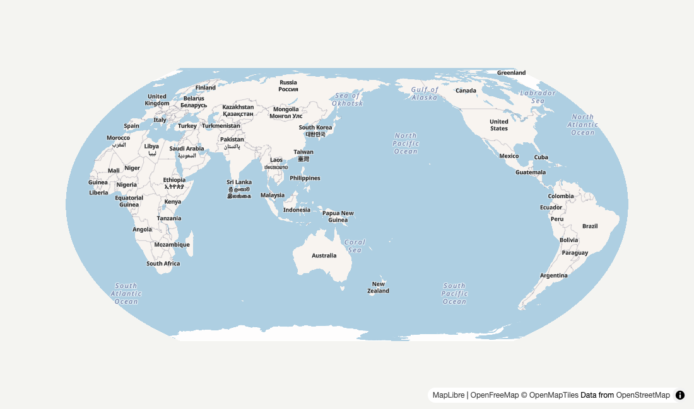

# equal-earth-gl

Interactive vector maps in the [Equal Earth projection](https://en.wikipedia.org/wiki/Equal_Earth_projection), where every country covers its true share of the map.



**equal-earth-gl** is a fork of [MapLibre GL JS](https://github.com/maplibre/maplibre-gl-js) 6.18. It has the same API, reads the same styles and uses the same Web Mercator tile sources. The difference is the projection: a style that names none is drawn in Equal Earth (EPSG:8857), at every zoom level.

- **Your tiles stay as they are.** Vector, raster and raster-dem tiles in Web Mercator are warped onto the Equal Earth plane on the GPU.
- **Everything MapLibre draws.** All layer types, labels, 3D buildings, 3D terrain, image sources, markers, popups, controls, `fitBounds` and feature queries.
- **Any central meridian.** Center the world on the Pacific, the Americas or anywhere else, at load or at runtime.
- **Exact GeoJSON.** GeoJSON is tiled on the Equal Earth plane itself, up to both poles.
- **Native Equal Earth tiles.** Sources cut in EPSG:8857 are drawn without the warp, next to Mercator ones.
- **Still MapLibre.** `mercator`, `globe` and `vertical-perspective` are drawn as upstream draws them.

## Install

```bash
npm install equal-earth-gl
```

The package holds `dist/maplibre-gl.mjs`, `dist/maplibre-gl.css` and the TypeScript types. The file names are upstream's, so a project that already uses MapLibre GL JS only changes the package it imports from.

## Use

```html
<link rel="stylesheet" href="https://unpkg.com/equal-earth-gl@latest/dist/maplibre-gl.css" />
<div id="map" style="width: 100%; height: 500px;"></div>
<script type="module">
import * as maplibregl from 'https://unpkg.com/equal-earth-gl@latest/dist/maplibre-gl.mjs';

const map = new maplibregl.Map({
    container: 'map',
    style: 'https://tiles.openfreemap.org/styles/bright',
    center: [0, 0],
    zoom: 1
});
</script>
```

With a bundler, import the package and its stylesheet:

```js
import * as maplibregl from 'equal-earth-gl';
import 'equal-earth-gl/dist/maplibre-gl.css';
```

The style has no `projection`, so the map is drawn in Equal Earth. To choose at runtime:

```js
map.setProjection({type: 'equal-earth'});
map.setProjection({type: 'mercator'});

// Draw styles without a `projection` in Mercator, as MapLibre GL JS does.
maplibregl.setDefaultProjection('mercator');
```

### Center the world elsewhere

```js
map.on('style.load', () => {
    map.setProjection({type: 'equal-earth', 'central-meridian': 150});
});
```

### A thematic map from GeoJSON

```js
map.addSource('countries', {type: 'geojson', data: 'countries.geojson'});
map.addLayer({
    id: 'population-density',
    type: 'fill',
    source: 'countries',
    paint: {
        'fill-color': ['interpolate', ['linear'], ['get', 'density'], 0, '#f7fbff', 500, '#08306b']
    }
});
```

Because areas are true, the amount of color a country gets matches its size on the ground, which is what a choropleth needs.

### Tiles cut in the Equal Earth grid

```js
map.addSource('population', {
    type: 'raster',
    tiles: ['https://example.com/population/{z}/{x}/{y}.png'],
    tileSize: 256,
    tileGrid: 'equal-earth'
});
```

## What is different from a Mercator map

- There is one world, with a left and a right edge. `renderWorldCopies` has no effect.
- The area around the outline of the world is transparent, so the page shows through.
- Web Mercator tiles hold nothing beyond 85.05° of latitude. The strip from there to each pole is filled from the edge of the last row of tiles; GeoJSON reaches the poles.
- `central-meridian` and `tileGrid` are not part of the MapLibre style specification. This library validates them itself; other tools report them as unknown keys.
- Dash patterns, line patterns and the spacing of labels along lines stretch with the projection, most toward the poles.

The [guide](docs/guides/equal-earth.md) covers all of it: the central meridian, the Equal Earth tile grid and how to cut tiles for it, terrain, custom layers, and the limits.

## Examples

Three pages in [`test/examples`](test/examples) show the projection on its own:

- [A vector basemap](test/examples/display-a-vector-basemap-in-equal-earth.html)
- [A thematic map](test/examples/display-a-thematic-map-in-equal-earth.html)
- [A Pacific-centered map](test/examples/display-a-pacific-centered-map-in-equal-earth.html)

## Status

Versions read `6.18.0-ee.6`: MapLibre GL JS 6.18.0 plus the sixth Equal Earth release. The [changelog](CHANGELOG.md) lists what each one added.

The unit, build and render test suites of upstream run against the fork, together with about 80 render tests for the projection. Positions computed on the CPU and on the GPU agree to 0.05 pixels at every zoom level. It has been checked in Chrome on macOS; other browsers and platforms have not been checked yet, and rendering speed has not been compared with upstream's.

## Develop

```bash
npm ci                 # needs Node 26
npm run build-dist     # build dist/
npm run test-unit      # unit tests
npm run test-render    # render tests
npm run lint
npm run typecheck
```

The fork is additive: the projection is a new world plane and a tile warp behind MapLibre's own seams, so upstream changes merge in. The [design](docs/superpowers/specs/2026-11-16-equal-earth-design.md) explains how it works. Issues and pull requests are welcome; [AGENTS.md](AGENTS.md) holds the code conventions.

## Credits and license

This is MapLibre GL JS with one more projection, and nearly all of the code is the work of the [MapLibre](https://maplibre.org/) contributors and, before them, of Mapbox. It contains no code from Mapbox GL JS 2 or later. The Equal Earth projection is by Bojan Šavrič, Tom Patterson and Bernhard Jenny (2018).

The map in the picture is © [OpenFreeMap](https://openfreemap.org/), © [OpenMapTiles](https://openmaptiles.org/), with data from [OpenStreetMap](https://www.openstreetmap.org/copyright).

Licensed under the [3-Clause BSD license](LICENSE.txt), as upstream.
